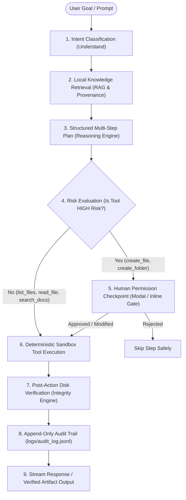

# LocoPilot — Complete System Architecture & Component Breakdown

> **LocoPilot: Privacy-First, On-Device AI Workspace Assistant**  
> *100% Local Inference &bull; Deterministic 5-Tool Sandbox &bull; Human-in-the-Loop Permission Gates &bull; Automated Post-Action Verification &bull; Append-Only Audit Trail*

---

## 1. High-Level Architecture Overview

LocoPilot is architected to operate strictly inside the user's local computing environment with zero external telemetry or cloud dependencies. It safeguards user privacy by using an on-device Large Language Model (Ollama with `qwen3:8b`), local semantic vector indexing (TF-IDF / BM25 lexical + vector chunking), deterministic file system tools restricted to a sandboxed `/workspace` folder, and an explicit interactive human permission checkpoint before any write actions occur.

### Core Execution Pipeline

---

## 2. End-to-End Workflow: PDF Extraction, Summary Generation, PDF Creation & Human-in-the-Loop

Here is the exact lifecycle of the PDF pipeline verified in LocoPilot:

1. **PDF Data Extraction (`load_document` in `rag.py` & `read_file` in `tools.py`):**
   - When a user uploads or references a PDF (e.g. `workspace/Gen AI_assignment_1.pdf`), the backend uses `pypdf.PdfReader` to extract text page-by-page.
   - Text is formatted with clear page boundaries (`--- Page 1 ---`, etc.) and indexed in the local knowledge base.
   - Also supports `.pptx`, `.docx`, `.md`, `.txt`, `.csv`, `.json`.

2. **Semantic Search & Context Retrieval (`search` in `rag.py`):**
   - Text is split into semantic chunks with configurable overlap.
   - A sub-millisecond local TF-IDF / BM25 index retrieves top-k relevant chunks based on user queries, providing exact provenance with filenames and chunk scores.

3. **Synthesis & Plan Generation (`agent_orchestrator.py` & `planner.py`):**
   - The LLM receives the grounded context and constructs an execution plan or summary.
   - When generating an artifact (e.g., an executive summary or tailored application), it designates the destination file (e.g., `output/summary.pdf`).

4. **Human Permission Checkpoint (`permission.py`):**
   - Before `create_file` executes on disk, LocoPilot checks if the tool is in `high_risk_tools` (`create_file`, `create_folder`).
   - If HIGH risk, the execution engine **pauses** using an `asyncio.Future`.
   - An interactive permission gate is sent via Server-Sent Events (SSE) to the frontend, displaying:
     - Target file path
     - Risk level (`HIGH`)
     - Reason for the action
     - Content preview
     - **"✓ Approve Action"** and **"✗ Reject Action"** buttons.
   - The user must explicitly approve before the file is written.

5. **Binary PDF Generation (`pdf_generator.py`):**
   - When approved, `create_file` routes PDF requests to `generate_pdf_from_markdown`.
   - Uses `reportlab` to compile structured Markdown headings, bullet points, horizontal rules, and tables into a clean, formatted binary PDF.

6. **Post-Action Disk Verification (`verifier.py`):**
   - The verifier immediately inspects disk state: confirms file existence, validates byte size > 0, reads headers (e.g. `%PDF-` signature), and checks readability.
   - Result is reported to the user and recorded to `logs/audit_log.jsonl`.

---

## 3. Detailed File-by-File Breakdown

### Root Directory

| File | Purpose & Responsibilities |
| :--- | :--- |
| [`run.py`](file:///c:/Users/1shre/OneDrive/Desktop/project/Locopilot/Locopilot/run.py) | **Main Application Entry Point.** Runs environment pre-flight diagnostics and starts the Uvicorn FastAPI server on `http://127.0.0.1:8000`. |
| [`setup_check.py`](file:///c:/Users/1shre/OneDrive/Desktop/project/Locopilot/Locopilot/setup_check.py) | **Pre-flight Diagnostic Utility.** Verifies Python version (&ge; 3.10), critical dependencies (`reportlab`, `scikit-learn`, `pypdf`, `python-docx`, `python-pptx`, etc.), Ollama reachability, and model availability. |
| [`pdf_generator.py`](file:///c:/Users/1shre/OneDrive/Desktop/project/Locopilot/Locopilot/pdf_generator.py) | Root-level shortcut proxy to `backend.core.pdf_generator` for standalone generation scripts and testing. |
| [`requirements.txt`](file:///c:/Users/1shre/OneDrive/Desktop/project/Locopilot/Locopilot/requirements.txt) | Python dependencies list configured for pure local execution (zero heavy cloud libraries). |
| [`README.md`](file:///c:/Users/1shre/OneDrive/Desktop/project/Locopilot/Locopilot/README.md) | Project introduction, architecture summary, live demo instructions, and quick start guide. |

---

### Backend Core (`backend/` & `backend/core/`)

| File | Purpose & Responsibilities |
| :--- | :--- |
| [`backend/app.py`](file:///c:/Users/1shre/OneDrive/Desktop/project/Locopilot/Locopilot/backend/app.py) | **FastAPI Server & REST / SSE Endpoints.** Exposes `/api/health`, `/api/chat/stream`, `/api/agent/run`, `/api/workspace/files`, `/api/workspace/upload`, `/api/chat/sessions`, `/api/permission/respond`, and `/api/audit/export`. |
| [`backend/core/config.py`](file:///c:/Users/1shre/OneDrive/Desktop/project/Locopilot/Locopilot/backend/core/config.py) | **Central Settings & Paths.** Manages paths for workspace, logs, Ollama endpoint (`http://localhost:11434`), target model (`qwen3:8b`), chunking parameters, and tool risk definitions. |
| [`backend/core/llm.py`](file:///c:/Users/1shre/OneDrive/Desktop/project/Locopilot/Locopilot/backend/core/llm.py) | **Local LLM Client Interface.** Communicates with the local Ollama instance; supports asynchronous text generation, streaming token delivery, and JSON-constrained responses. |
| [`backend/core/rag.py`](file:///c:/Users/1shre/OneDrive/Desktop/project/Locopilot/Locopilot/backend/core/rag.py) | **Personal Knowledge Engine (RAG).** Extracts text from PDF, PPTX, DOCX, MD, TXT, CSV; splits into semantic chunks; builds local TF-IDF matrices; retrieves top-k context with citations. |
| [`backend/core/tools.py`](file:///c:/Users/1shre/OneDrive/Desktop/project/Locopilot/Locopilot/backend/core/tools.py) | **Deterministic 5-Tool Sandbox.** Implements `list_files`, `read_file`, `search_documents`, `create_file`, and `create_folder`. Enforces strict path sandboxing preventing directory traversal outside `/workspace`. |
| [`backend/core/pdf_generator.py`](file:///c:/Users/1shre/OneDrive/Desktop/project/Locopilot/Locopilot/backend/core/pdf_generator.py) | **Local PDF Engine.** Converts Markdown and structured text into professional binary PDFs using ReportLab with custom typography, clean headers, and table formatting. |
| [`backend/core/planner.py`](file:///c:/Users/1shre/OneDrive/Desktop/project/Locopilot/Locopilot/backend/core/planner.py) | **Reasoning & Planning Module.** Classifies intent (`Q_AND_A`, `ANALYSIS`, `MULTI_STEP`, `ACTION`) and compiles user goals into structured, executable step-by-step plans with assigned risk levels. |
| [`backend/core/permission.py`](file:///c:/Users/1shre/OneDrive/Desktop/project/Locopilot/Locopilot/backend/core/permission.py) | **Human-in-the-Loop Gateway.** Evaluates action risk, halts execution on high-risk actions (`create_file`, `create_folder`), and delivers approval/rejection decisions back to the waiting orchestrator. |
| [`backend/core/agent_orchestrator.py`](file:///c:/Users/1shre/OneDrive/Desktop/project/Locopilot/Locopilot/backend/core/agent_orchestrator.py) | **Central State Machine & Pipeline Runner.** Coordinates the full lifecycle: understand &rarr; retrieve knowledge &rarr; plan &rarr; gate check &rarr; execute tool &rarr; verify &rarr; audit log &rarr; stream SSE events. |
| [`backend/core/chat.py`](file:///c:/Users/1shre/OneDrive/Desktop/project/Locopilot/Locopilot/backend/core/chat.py) | **Conversational Stream Manager.** Routes user chat queries between conversational streaming with verified workspace knowledge or full multi-step agent workflows. |
| [`backend/core/chat_history.py`](file:///c:/Users/1shre/OneDrive/Desktop/project/Locopilot/Locopilot/backend/core/chat_history.py) | **Multi-Session Storage.** Persists conversations in `logs/chat_sessions/*.json` with session management, listing, retrieval, and deletion. |
| [`backend/core/verifier.py`](file:///c:/Users/1shre/OneDrive/Desktop/project/Locopilot/Locopilot/backend/core/verifier.py) | **Post-Action Integrity Verification.** Verifies file creation, byte sizes, non-empty content, and binary signatures on disk to prevent hallucinated success. |
| [`backend/core/audit.py`](file:///c:/Users/1shre/OneDrive/Desktop/project/Locopilot/Locopilot/backend/core/audit.py) | **Append-Only Audit Logging.** Thread-safe JSONL logger writing all events, timestamps, and tool results to `logs/audit_log.jsonl`, with CSV export capabilities. |

---

### Frontend UI (`frontend/`)

| File | Purpose & Responsibilities |
| :--- | :--- |
| [`frontend/index.html`](file:///c:/Users/1shre/OneDrive/Desktop/project/Locopilot/Locopilot/frontend/index.html) | **Dashboard Markup.** Clean, accessible desktop UI featuring Top Navigation, Stage Ribbon, Left Sidebar (Sessions, Workspace Files, Demo Scenarios), Chat Stream / Execution Feed, Input Box, and Slide-over Audit Drawer. |
| [`frontend/styles.css`](file:///c:/Users/1shre/OneDrive/Desktop/project/Locopilot/Locopilot/frontend/styles.css) | **Professional Workspace Theme.** Eye-friendly slate/charcoal dark theme (`#12151c`), clear high-contrast borders, solid badges, accessible typography (`Inter` & `JetBrains Mono`), and minimal distractions (free of glowing neon AI aesthetics). |
| [`frontend/app.js`](file:///c:/Users/1shre/OneDrive/Desktop/project/Locopilot/Locopilot/frontend/app.js) | **Frontend Application Controller.** Handles SSE stream ingestion, interactive permission card approvals/rejections, session switching, file drag-and-drop, and audit log presentation. |

---

### Tests & Verification (`tests/` & `backend/tests/`)

| File | Purpose & Responsibilities |
| :--- | :--- |
| [`tests/run_tests.py`](file:///c:/Users/1shre/OneDrive/Desktop/project/Locopilot/Locopilot/tests/run_tests.py) | Runner script executing all test suites and outputting comprehensive status reports. |
| [`tests/test_fixes.py`](file:///c:/Users/1shre/OneDrive/Desktop/project/Locopilot/Locopilot/tests/test_fixes.py) | End-to-end integration tests covering environment verification, PDF generation, audit export, session persistence, and intent routing. |
| [`tests/test_e2e_sequence.py`](file:///c:/Users/1shre/OneDrive/Desktop/project/Locopilot/Locopilot/tests/test_e2e_sequence.py) | Full multi-turn agent conversation and workflow integration tests. |
| [`tests/test_direct_summary.py`](file:///c:/Users/1shre/OneDrive/Desktop/project/Locopilot/Locopilot/tests/test_direct_summary.py) | Tests verifying direct document summarization and output generation. |
| [`tests/test_deictic_save_guardrail.py`](file:///c:/Users/1shre/OneDrive/Desktop/project/Locopilot/Locopilot/tests/test_deictic_save_guardrail.py) | Tests for deictic reference resolution ("this pdf", "save that response"). |
| [`backend/tests/test_rag.py`](file:///c:/Users/1shre/OneDrive/Desktop/project/Locopilot/Locopilot/backend/tests/test_rag.py) | Unit tests verifying document chunking, indexing, and vector/lexical retrieval. |
| [`backend/tests/test_tools.py`](file:///c:/Users/1shre/OneDrive/Desktop/project/Locopilot/Locopilot/backend/tests/test_tools.py) | Unit tests verifying sandbox boundary enforcement and the 5 deterministic tools. |
